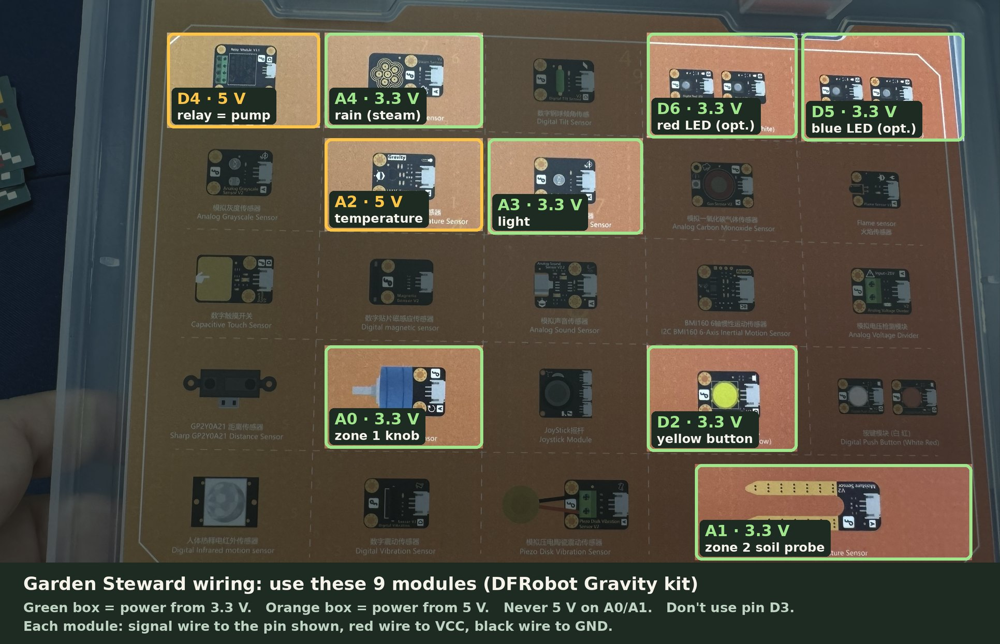

# Garden Steward – design

> A solar-powered Arduino UNO Q watches a garden, decides when to water and explains why.
> It runs **fully offline**, with **Gemma 4 E2B running on the board itself**.

## Decisions so far

| Question | Answer | Consequence |
|---|---|---|
| Board | **UNO Q 4 GB** | Gemma 4 E2B *should* fit, but the llama.cpp file is 3.35 GB (+0.99 GB vision); Phase 0 checks it |
| Connectivity | **Never online** | No cloud and no Gemini API at runtime. Everything is local |
| Where | **Garden** (outdoor) | Weatherproof box, water tank, real sensors (later) |
| Power | **Solar + battery** | The power budget matters; measure it in Phase 0 |
| First demo | **"Paper Garden"** | No water: soil and pump are simulated, garden drawn on paper |

---

## 1. The big picture

```
                     ┌─────────────────────── Arduino UNO Q (4 GB) ───────────────────────┐
  soil, temp,        │                                                                    │
  pressure, light ──►│  MCU  (STM32U585)                 Linux  (Qualcomm QRB2210)        │
                     │  • reads sensors every few s      • garden app (Python)            │
  pump / valve   ◄───│  • drives pump relay        Bridge• Gemma 4 E2B (llama.cpp)        │
                     │  • SAFETY LIMITS          ◄──RPC──► • decision log                 │
  LED matrix     ◄───│  • LED matrix status              • local web page                 │
                     └────────────────────────────────────────────────▲───────────────────┘
                                                                      │ the board's own Wi-Fi
  solar panel ─► charge controller ─► battery ─► 5 V USB-C ─► board   │ (no internet)
                                                                   📱 your phone
```

- **MCU (the "reflexes"):** real-time, always on, cheap on power. It owns everything physical
  and the hard safety rules.
- **Linux side (the "brain"):** runs the garden app and Gemma 4. It thinks occasionally.
- **Bridge:** the built-in RPC link. Python calls `water(zone, seconds)` and the sketch runs it.
- **Your phone:** connects to the board's own Wi-Fi hotspot (no internet) to see the log and ask questions.

## 2. One decision, step by step

1. **Sense.** The MCU reads the sensors every few seconds.
2. **Summarise.** Every 2 h (or when soil crosses a threshold), Python asks the MCU for readings over the
   Bridge and computes the numbers: trend per hour, pressure change over 3 h, hours since last watering.
3. **Prompt.** Python builds a short prompt: the garden profile, the summary and the list of allowed actions.
4. **Think.** **Gemma 4 E2B** answers with one action as JSON and a one-line reason.
5. **Check (software).** Python validates the JSON (known action, numbers in range).
6. **Check (hardware).** Python calls the MCU. The MCU applies its **hard limits** and runs the pump or refuses.
7. **Show.** The log, LED matrix and web page are updated with the action and Gemma's reason.

If Gemma times out or returns nonsense, a simple **fallback rule** takes over
("water 20 s if soil < 25 %"). The garden never depends on the AI being right.

## 3. How Gemma 4 is used

Gemma 4 **E2B** is the smallest Gemma 4 model. It takes text, images and audio, supports
function calling, is open (Apache 2.0) and is small enough to run on the UNO Q with no internet.
It runs inside **llama.cpp** on the Linux side. LiteRT‑LM is the alternative; Phase 0 picks the faster one.

Gemma has **three jobs**:

| Job | When | Input | Output |
|---|---|---|---|
| **Decide** | every ~2 h + on threshold | text summary of sensors | one action: `water` / `wait` / `alert` + reason |
| **See** | once a day (or on demand) | a photo of the plants | `{status, issue, confidence}` |
| **Explain** | evening + when you ask | the day's log, or your question | a short journal entry / answer |

### Example: "Decide"

What Python sends (built from sensor numbers):

```
Time 07:10. Zone 1 tomatoes: soil 28 % (target 35-60 %), falling 3 %/h.
Zone 2 lettuce: soil 52 %, stable.
Air 27 °C, humidity 40 %. Pressure 1006 hPa, down 4 hPa in 3 h.
Battery 78 %. Zone 1 last watered 22 h ago.
```

What Gemma answers. The JSON shape is enforced by llama.cpp's grammar‑constrained decoding,
so the model *cannot* produce broken JSON:

```json
{"action": "water", "zone": 1, "seconds": 30,
 "reason": "Tomatoes below target and drying fast; rain not certain, short drink."}
```

### What Gemma does **not** do
- **Maths:** Python computes trends and averages; Gemma interprets them.
- **Safety:** the MCU enforces limits Gemma can't override.
- **Timing / control loops:** the MCU handles real time.

### Why Gemma 4 (and not a bigger cloud model)
- **Offline:** open weights running on the board. No internet, no API key, no subscription.
- **Small enough (to be confirmed):** built for phones (~1.5 GB peak on a Raspberry Pi 5 with LiteRT‑LM). The llama.cpp file is 3.35 GB, so fitting the 4 GB board is Phase 0's first question. Smaller 2.4–2.5 GB versions exist.
- **One model, many senses:** text, vision and audio in one model, so no separate image model is needed.
- **Function calling:** made for "pick an action" tasks.
- **Same family scales up:** the 26B/31B models are there if it ever goes online.

## 4. Safety: "Gemma proposes, the microcontroller disposes"

Enforced in the MCU sketch. The same rules apply in the simulation:

| Rule | Value (default) |
|---|---|
| Max pump run per watering | 60 s |
| Min time between waterings, per zone | 4 h (sim: 4 simulated hours) |
| Max waterings per zone per day | 3 |
| No watering if battery below | 20 % |
| No watering if tank empty | float switch (real) / simulated flag |

If Gemma (or the web page's **Force** button) asks for "water zone 1 for 10 minutes", the MCU caps it at 60 s.
Asking again within 4 simulated hours is refused outright. The demo shows this on purpose.

## 5. The "Paper Garden" simulation (first demo)

No water and no plants needed. **The brain is real; only the garden is pretended.**

| Part | Real garden (later) | Paper Garden (now) |
|---|---|---|
| Soil moisture | capacitive soil sensors | Zone 1: **a knob** you turn to "dry" the soil. Zone 2: **a real soil probe** in a damp tissue. Both get a simulated "watering bonus" when the MCU accepts a watering |
| Pump | 12 V pump via relay/MOSFET | **relay click** + water-drop animation on the LED matrix |
| Weather | temp/humidity/pressure sensor | **real** temperature (LM35), light and rain (steam sensor) readings; the pressure forecast comes from **scenario buttons** (Normal, Heatwave, Rain coming) |
| Plants | real plants + camera | **drawings on paper**, photographed with a **phone** on the web page, or the built-in **test drawings** (healthy / sick) |
| Battery / solar | solar panel + LiFePO4 | simulated battery level |
| Gemma, Bridge, safety rules, log, web page | ✅ real | ✅ **real – identical code** |

**Time runs fast:** 1 real minute = 1 simulated hour, so a full day takes ~24 minutes.

### Demo script (for the presentation)
1. **Show the paper garden** (e.g. Zone 1 tomatoes, Zone 2 lettuce) and the web page on a phone.
2. **Press "Dry zone 1"** (and "Heatwave"), then "Ask Gemma to decide now". Gemma decides to water; the
   board's LED matrix shows drops and the log shows the reason. (With sensors wired: turn the knob instead.)
3. **Press "Rain coming"** and ask again (or a wet fingertip on the rain sensor). Gemma skips watering and says why.
4. **Try to overwater it:** "Force: water zone 1 for 10 min". The **MCU cuts it to 60 s**; a second press is refused.
5. **Sick plant:** pick the "sick" test drawing (or photograph a yellow/brown paper drawing with the phone)
   and press "Check now". Gemma flags it.
6. **Ask a question:** "How's the lettuce doing?" Gemma answers from the log.

## 6. Power budget (real deployment – estimates, to be measured in Phase 0)

| Consumer | Assumption | Per day |
|---|---|---|
| UNO Q always on (+ sensors) | ~2 W average (unmeasured; ~1 W idle is reported) | ~48 Wh |
| Gemma thinking | 12 decisions × 60 s × ~5 W (guess) | ~1 Wh |
| Pump | 12 V × 1 A × 2 min | ~0.4 Wh |
| **Total** | | **~50 Wh/day** |

**Key insight:** the AI is *not* the energy problem (~2 %). Keeping Linux awake is.

Rough sizing: **3 days without sun** ≈ 150 Wh usable, so a **12 V 20 Ah LiFePO4** (~256 Wh)
plus a **30–50 W panel** and an MPPT charge controller.

### Wiring: your parts (DFRobot Gravity kit KIT0011)



The UNO Q's pins are **3.3 V logic**. A0/A1 are **not** 5 V tolerant, analog inputs top out around 3.3 V, and D3 is avoided.
Each Gravity module has 3 wires: **signal**, **VCC** (red), **GND** (black).

| Pin | Module | Role in the Paper Garden | Power |
|---|---|---|---|
| A0 | Analog Rotation Sensor (blue knob) | Zone 1 "soil dial" | 3.3 V |
| A1 | Soil Moisture Sensor (fork probe) | Zone 2 real moisture (probe in a damp tissue) | 3.3 V |
| A2 | LM35 temperature sensor | real temperature (pinch it for a "heatwave") | 5 V (its output is only ~0.25 V, so it is safe) |
| A3 | Ambient Light Sensor | real light (cover it for "night") | 3.3 V |
| A4 | Steam Sensor | "raining now" (wet fingertip) | 3.3 V |
| D2 | Yellow push button | "check now": take a photo and decide | 3.3 V |
| D4 | Relay Module (DFR0017) | the "pump" (it clicks) | 5 V (to verify: the 3.3 V signal switches it) |
| D5 | Blue LED module (optional) | "water flowing" | 3.3 V |
| D6 | Red LED module (optional) | alert | 3.3 V |

**No camera:** the photo comes from the phone (the web page opens its camera) or from the built-in test
drawings. A Seeed reCamera on the same Wi‑Fi is supported but optional.
**Cables:** if the Gravity cables end in plugs that don't fit the UNO Q's female headers, use male-to-male
jumper wires or a DFRobot Gravity IO expansion shield.

## 7. Parts

**Paper Garden (what we have):** one UNO Q 4 GB (shared material), USB‑C cable and power supply, the
DFRobot Gravity 27‑piece sensor kit (see the wiring table above), paper, pens and a phone.
No camera: a USB webcam would also need a USB‑C hub with power delivery (the UNO Q has a single USB‑C port).

**Test environment (no board, no camera):** `python3 app/garden-steward/python/laptop.py` runs everything on a
laptop. A test bench on the web page stands in for the sensors and the yellow button, and built-in test
drawings stand in for the camera. See the app README, section 4.

**Real garden (later):** capacitive soil sensors (I²C/Qwiic), 12 V pump or valve + relay/MOSFET,
float switch for the tank, a **real-time clock module** (no internet means no clock sync),
battery monitor (INA226-type), solar panel, MPPT controller, LiFePO4 battery, 12 V→USB‑C PD
converter, IP65 box with cable glands.

## 8. Unknowns to settle in Phase 0

| Unknown | Why it matters | Plan B |
|---|---|---|
| E2B speed on UNO Q (est. 2–4 tok/s) | sets how often Gemma can think | shorter prompts, or Gemma 3 1B for "Decide" |
| E2B RAM with App Lab running | 3.35 GB model + 0.99 GB vision on 4 GB shared with Debian; App Lab's LLM container is capped at 2.5 GB | `VISION=0`, a 2.4–2.5 GB quantization, llama.cpp outside App Lab, or LiteRT‑LM |
| Arduino lists Gemma 4 E2B only for the VENTUNO Q | App Lab's LLM brick may not serve it on the UNO Q | run `llama-server` ourselves (`LLM_BASE_URL`) |
| Gemma 4 vision on the board | the "See" job (works in llama.cpp on a laptop: spots yellow/brown, not droopy shapes) | phone upload, or drop vision from the POC |
| Board as Wi-Fi hotspot | the phone without internet | a laptop/phone hotspot with no uplink, or LED matrix only |
| Real power draw | solar sizing | bigger battery/panel |

## 9. Plan

| Phase | What | Done when |
|---|---|---|
| 0 – Spike | Gemma 4 E2B on the board, measure speed/RAM/power | one JSON decision in < 90 s |
| 1 – Paper Garden | simulated soil + real Gemma + MCU safety + web page | demo script runs end to end |
| 2 – Real sensors | swap simulated soil/weather for real sensors | readings match reality |
| 3 – Outdoors | solar, battery, box, water | 48 h unattended, offline |

## 10. What the first test run showed (laptop, not the board yet)

The real Gemma 4 E2B (`google/gemma-4-E2B-it-qat-q4_0-gguf`) in llama.cpp, with the real prompts:

- **Decision time:** ~8 s at ~16 tok/s on a 4-core x86 machine. The UNO Q will be slower.
- **Hidden thinking:** E2B started reasoning out loud in 6 of 12 replies even with thinking off. An empty
  assistant prefill plus a zero reasoning budget fixed it (12 of 12).
- **Numbers:** it misread "33 %" as "below 25 %". Python now labels each zone (VERY DRY / below target /
  in target range) and adds rain to every zone's line. It then followed the rules in 13 of 14 checks.
- **Vision:** it reliably flags yellow/brown drawings, not green drooping ones, so sick plants get coloured.
  The built-in test drawings were judged correctly every time (healthy 3/3, sick 3/3, ~12–14 s each).

The code is in [`app/garden-steward/`](../app/garden-steward/README.md) and the Phase 0 test in [`spike/`](../spike/README.md).

## 11. Phase 0 on the UNO Q (measured, 17 Oct 2026)

Gemma 4 E2B, Google's QAT Q4_0 (3.35 GB) + Google's photo part (0.99 GB), Arduino's prebuilt llama.cpp,
4 threads, on the 4 GB UNO Q:

| What | Measured | Goal |
|---|---|---|
| One decision, cold | **166 s** (352 prompt + 126 answer tokens), correct and valid JSON | under 90 s |
| Writing speed (tg64) | 2.36 tok/s | 2+ |
| Reading speed (pp256) | 3.69 tok/s: reading the prompt is the slow part | |
| Peak memory (llama-server) | 3063 MB, of 3669 MB total (+1.8 GB swap) | |
| Disk | `/` and `/home` are one 9.8 GB disk, 2.8 GB free after the download | |

**Consequences**
- Gemma 4 runs as **our own llama.cpp server on the board** (`spike/serve_gemma.sh`), not in App Lab's
  `arduino:llm` brick (it offers only Gemma 3 1B / Qwen 3.5 0.8B on the UNO Q, its container is capped, and
  there's no room for a second copy of the model). The app finds the server by itself.
- **Prompt reuse** (`-np 1`): the ~200-token instructions never change, so a warm decision re-reads only
  the new report. **Measured on the board** (`serve_gemma.sh`, `SMALL_PHOTO=1`, 4 threads):

  | | Cold | Warm |
  |---|---|---|
  | Total | 159.2 s | **97.5 s** |
  | Prompt tokens read / reused | 352 / 0 | 137 / 200 |
  | Reading (prefill) | 103 s at 3.4 tok/s | **43 s** at 3.2 tok/s |
  | Writing (decode) | ~56 s, 114 tokens at 2.0 tok/s | ~55 s, 112 tokens at 2.0 tok/s |

  Both decisions were sensible (cold: water tomatoes 40 s, lettuce waits; warm: both wait). Writing is now
  the biggest cost: shorter `reason` strings are the next lever. Memory with the 0.56 GB photo part:
  llama-server peak 3074 MB (RSS 2684 MB), 2390 MB still available on the board (was 1942 MB).
- **Smaller photo part** (`SMALL_PHOTO=1`): ggml-org's 0.56 GB Q8_0 projector gives the same verdicts on both
  test drawings and ~0.4 GB less memory.
- **Live demo:** pause automatic decisions and ask Gemma on demand; talk while it thinks.
